# Biblioteca - autenticació amb JWT i CRUD

## Com executar-ho

```
npm install
npm run dev
```

Es pot veure a http://localhost:3000

Usuaris d'exemple (a `db/users.json`):

| Usuari | Contrasenya | Rol    |
|--------|-------------|--------|
| admin  | Admin1234   | admin  |
| anna   | Anna1234    | usuari |
| joan   | Joan1234    | usuari |

## Rutes

| Ruta | Què fa | Qui pot |
|------|--------|---------|
| POST /register, /login, /logout | registre, login i logout | tothom |
| GET /protected, /profile | pàgines privades | amb sessió |
| GET /admin | gestió d'usuaris | admin |
| GET, POST /books | llistar i crear llibres | amb sessió |
| GET /books/:id | veure un llibre | amb sessió |
| PUT, DELETE /books/:id | modificar i esborrar | propietari o admin |
| GET /users | llistar (l'admin veu tots els camps) | amb sessió |
| GET /users/:id | veure un usuari | ell mateix o admin |
| PUT /users/:id | modificar (el rol només l'admin) | ell mateix o admin |
| POST /users, DELETE /users/:id | crear i esborrar | admin |

Totes les operacions de l'API també es poden fer des de la web (taula de llibres a `/protected`, taula d'usuaris a `/admin` i formulari a `/profile`).

## Regles i validacions

- Només els usuaris autenticats accedeixen als CRUD.
- Un llibre només el pot modificar o esborrar el propietari o l'admin.
- No es poden repetir l'usuari, el correu ni el llibre (mateix títol i autor): error **409**.
- Usuari mínim 3 caràcters, correu vàlid, contrasenya mínim 6 i rol `admin` o `usuari`.
- Llibre: títol i autor obligatoris, any entre 1000 i l'any actual. Si no es compleix: error **400**.
- Al registrar-se el rol sempre és `usuari`.

## Proves i captures

**1. Login i registre** (login.ejs)

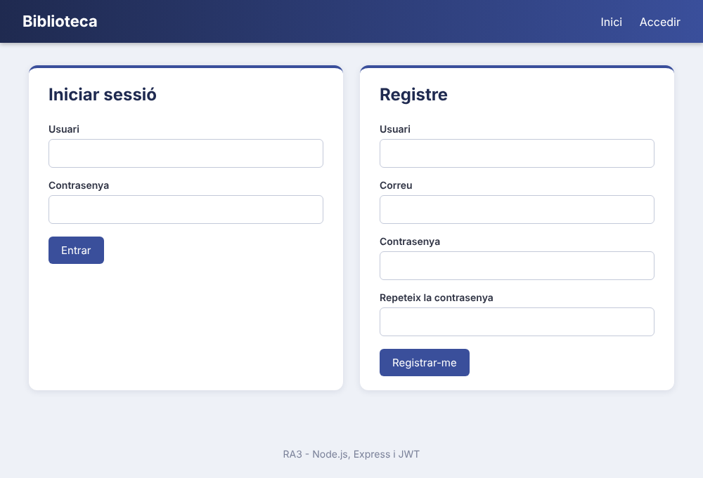

**2. Zona privada** (protected.ejs). Anna veu tots els llibres però només té Editar i Esborrar als seus.

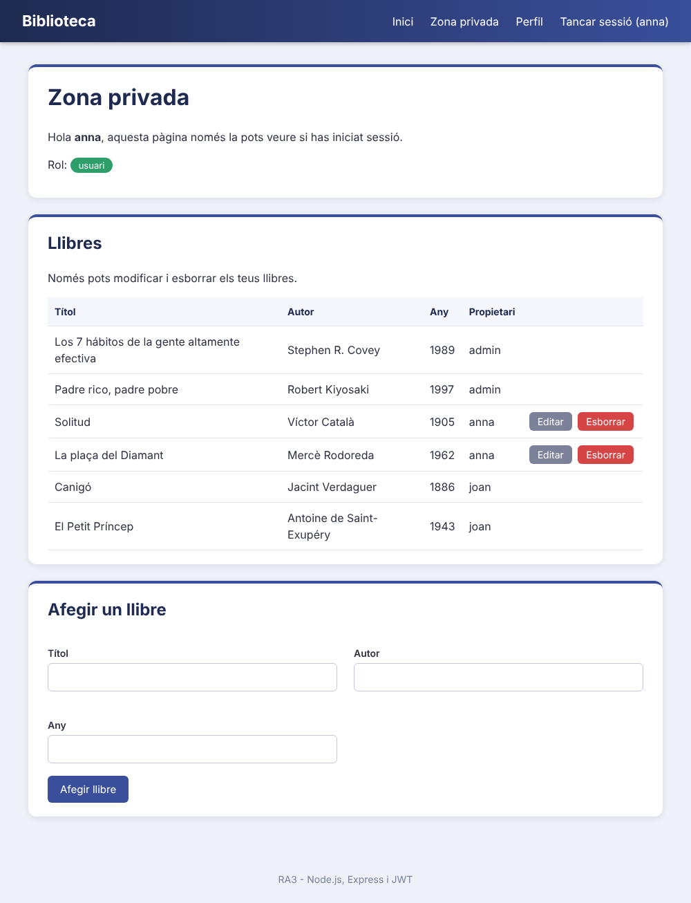

**3. Modificar un llibre.** El botó Editar passa les dades al formulari (PUT).

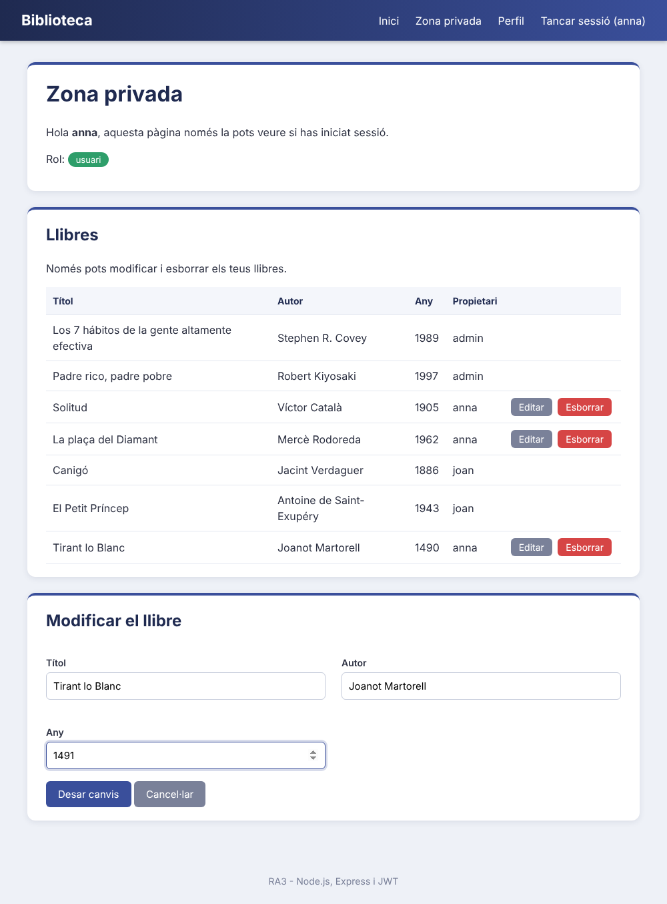

**4. Perfil** (profile.ejs) amb les dades de l'usuari i un formulari per canviar-les.

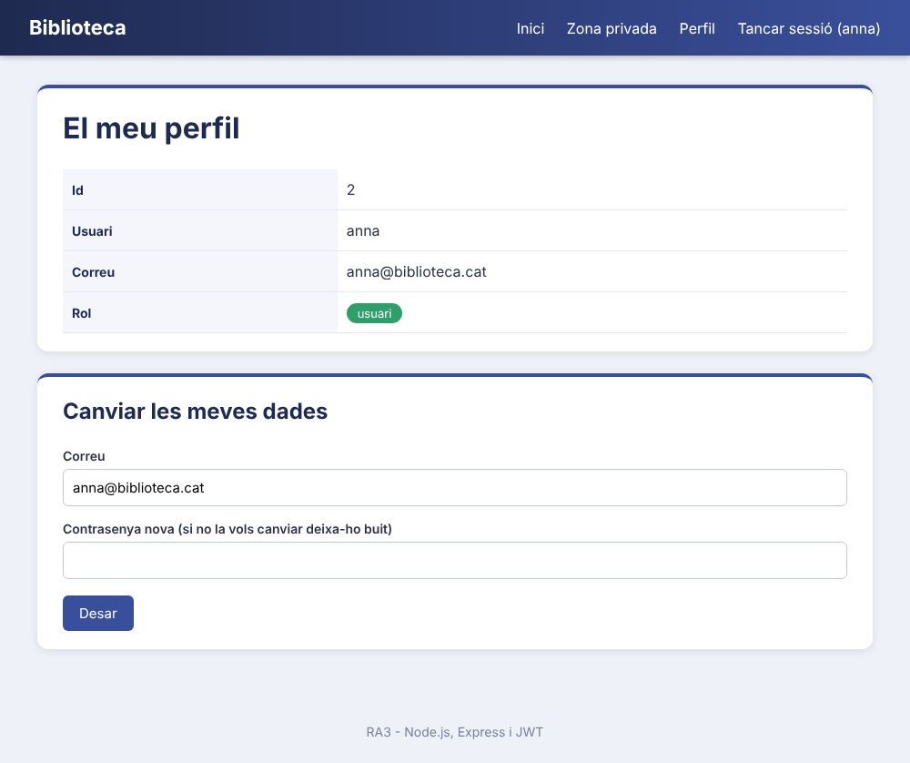

**5. Usuaris (només admin)** (admin.ejs). L'admin pot afegir, editar i esborrar usuaris.

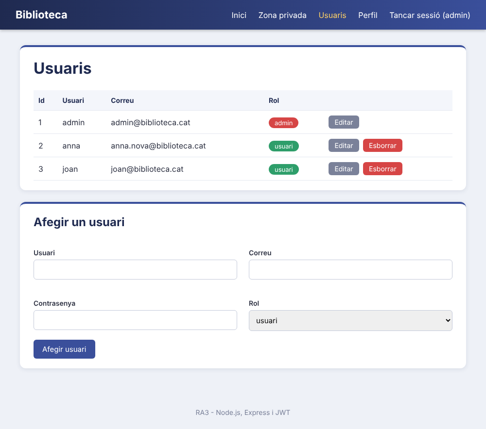

### API amb REST Client (`request.http`)

Les peticions s'executen en ordre, la cookie es guarda sola entre peticions.

**Autenticació**

1. Registre d'un usuari nou: 201 i es crea la cookie.


2. Login amb contrasenya incorrecta: 401.

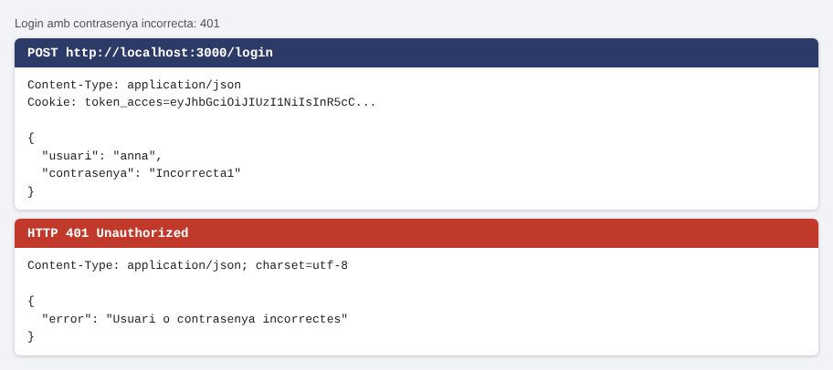

3. Login com a anna: 200 i es guarda el token.

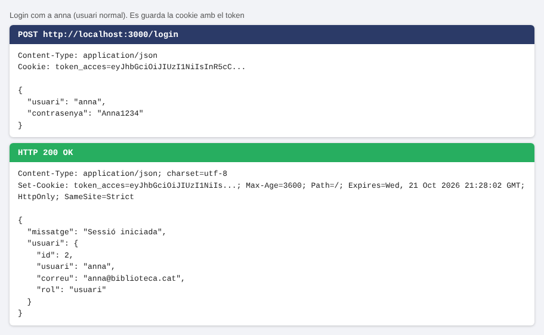

**CRUD de books**

4. GET: llista de llibres.

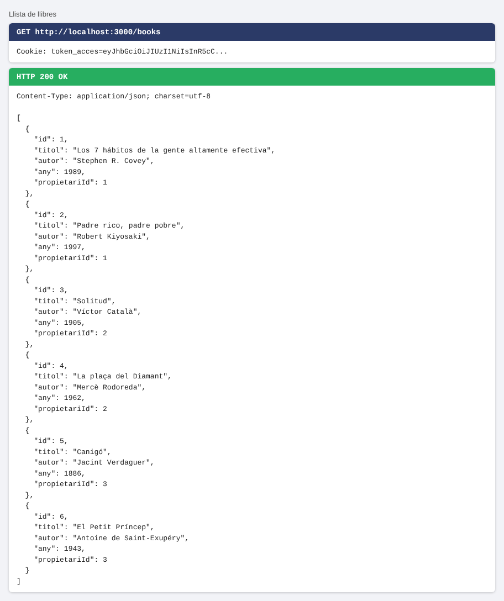

5. POST: crear un llibre, el propietari és anna (201).

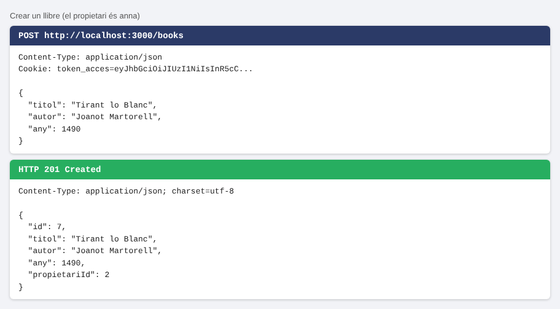

6. POST del mateix llibre un altre cop: 409.

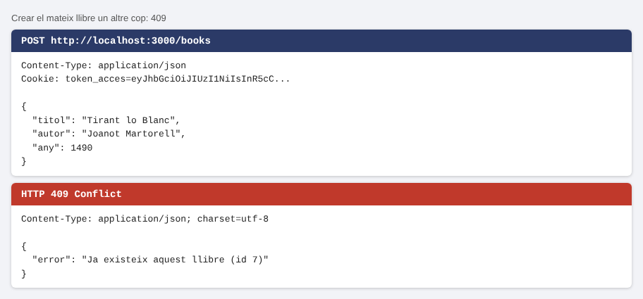

7. PUT: modificar un llibre propi.

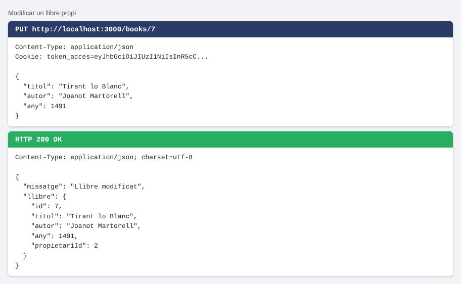

8. PUT d'un llibre d'un altre usuari: 403.

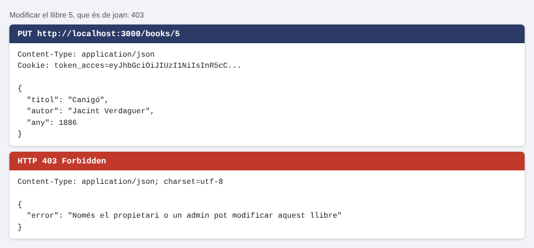

9. DELETE: esborrar el llibre creat.

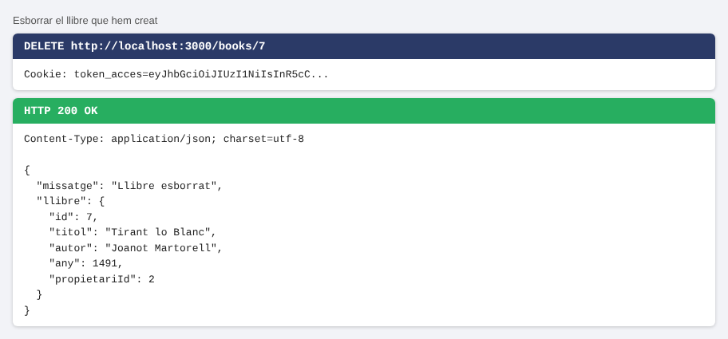

**Protecció de rutes**

10. Després de fer logout, `/books` sense sessió: 401.

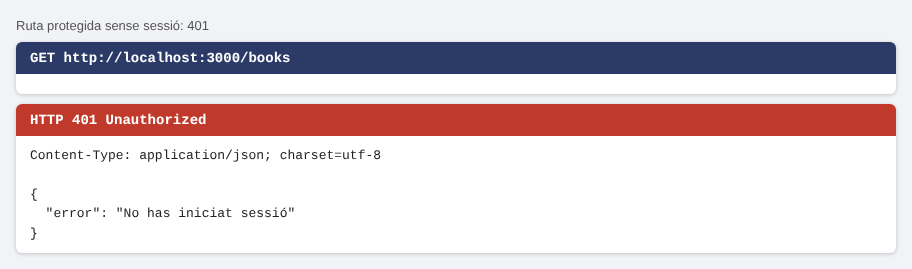

**CRUD de users (com a admin)**

11. GET (després de fer login com a admin): veu tots els usuaris, sense la contrasenya.

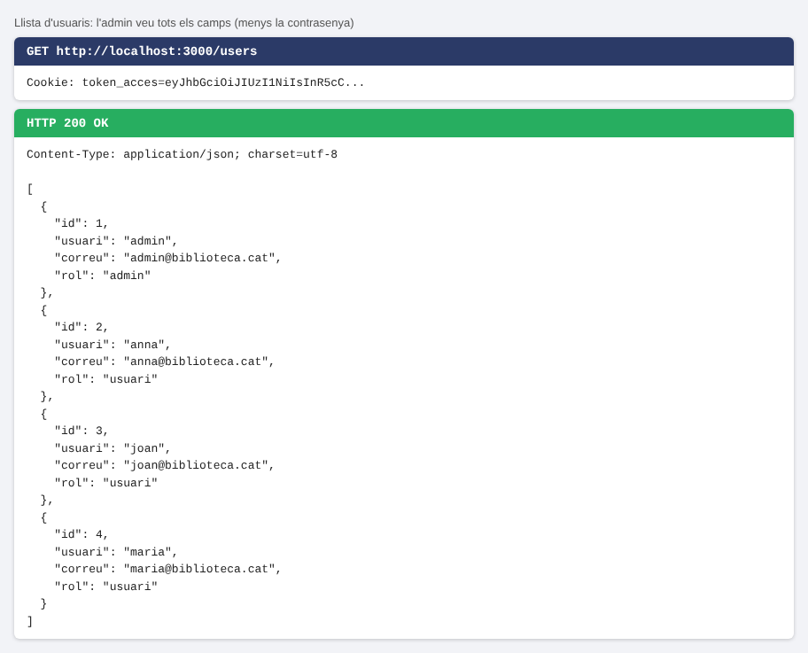

12. POST: crear l'usuari pere (201).

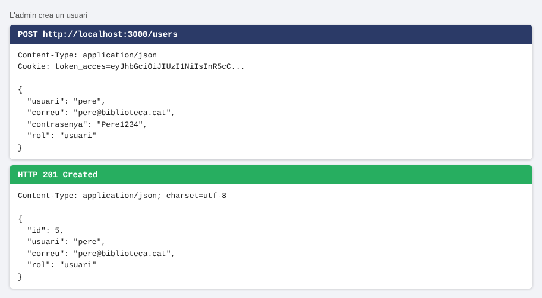

13. PUT: canviar el rol de pere a admin.

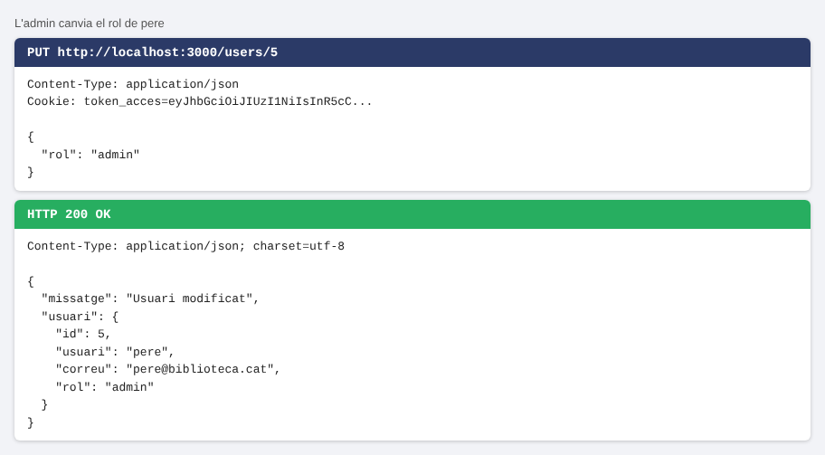

14. DELETE: esborrar pere.

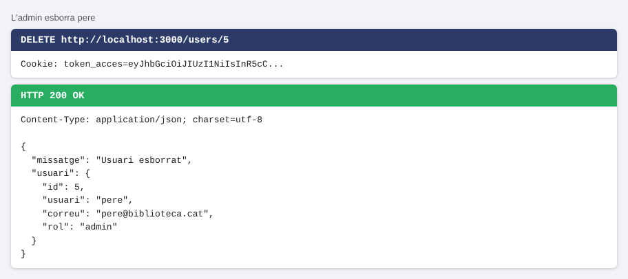